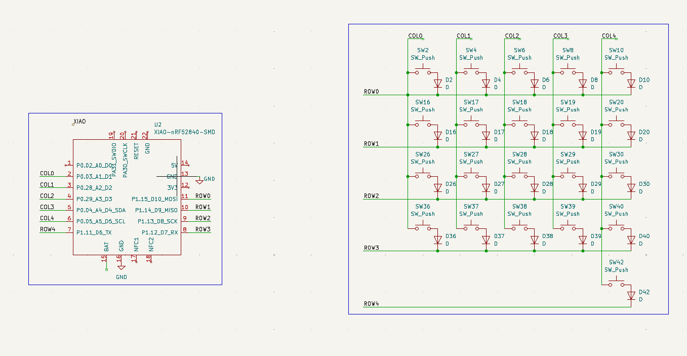
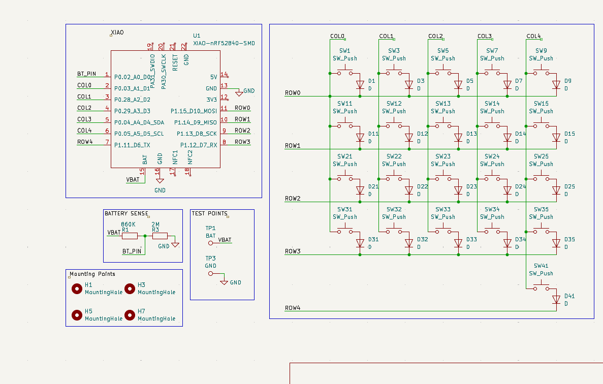
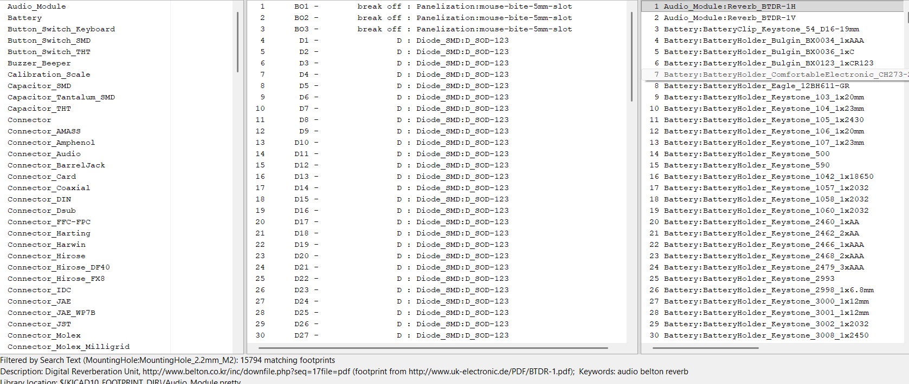

# October 1: Designed the schematic layout

Spent about an hour designing the schematic and trying to figure out how to import footprints and symbols. This was pretty simple because i already dealt with this once, but i faced problems this time too. Apart from that, i just followed the guide and added hierarchical sheets to build the schematic .

**Total time spent: 1 hour, 50% time logged on lapse**

# October 2: Completed designing the schematic

Spent about an 45 minutes finishing off the schematic adding the battery sense and the mounting holes (according to the guide). Struggled quite a bit at the mounting holes because i didnt know where to look for the right symbols

**Total time spent: 0.75hr**

# October 2: Assigned footprints to symbols

Simple step here. I assigned the correct footprints to the respective symbols and now, im ready to go for the pcb :D

**Total time spent: 0.25hr**

# October 4: Arranged switches in PCB

This was really tough. I spent a lot of time ordering the switches and arranging them in the correct position. I had to sit and drag each one of them separately and do it twice because i had 2 sets of keys :==. I next have to place all the 40 diodes in their places. Byee

**Total time spent: 1.3hrs**

# October 4: Arranged diodes in PCB

This was really tough, but easier compared to the previous step. I spent a little more time placing the diodes corresponding to the switches and arranged them in the same order as the switches in the position.

**Total time spent: 0.3hrs**

# October 21: Arrange Rest of the parts

I spent about an hour trying out different stuff and arrangements, turns out, i didnt know what the mousebites, the mounting points, resistors and the test points did, i broke my head over what to do with those, at the end, with some help, i managed to finish arranging those.

**Total time spent: 1hr**

# October 22: Correct key order

When i was about to start tracing the connections, i found out that all my switches were in the wrong order and were messed up, I was devastated at seeing that so i spent some time correcting their order, nd now its all neat.

**Total time spent: 0.5hr**
